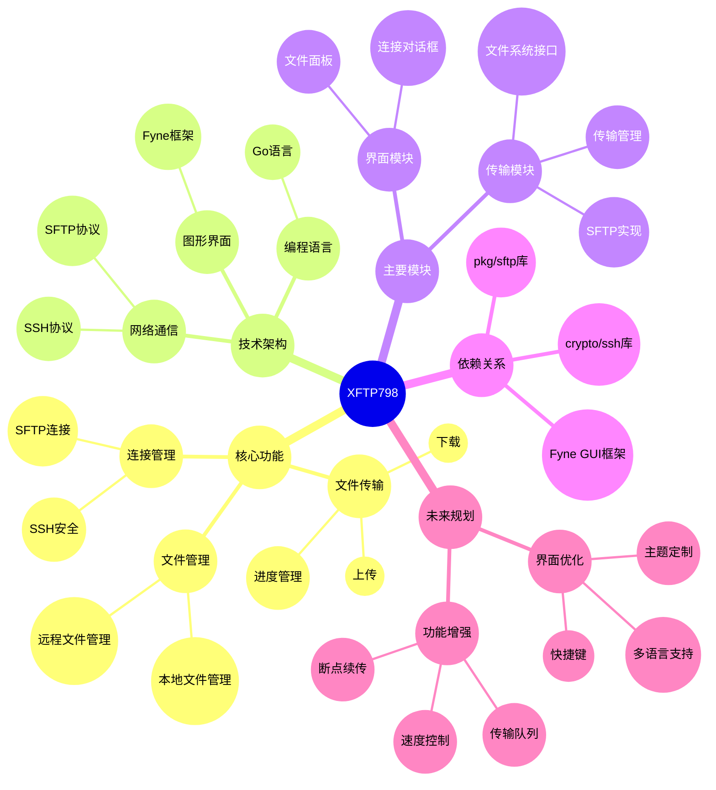

# XFTP798 项目架构思维导图

## 使用说明

1. 该思维导图使用Mermaid语法编写
2. 可以在支持Mermaid的Markdown编辑器中查看
3. 主要包含以下部分：
   - 核心功能：项目的主要功能模块
   - 技术架构：使用的技术栈和框架
   - 主要模块：代码层面的模块划分
   - 依赖关系：项目依赖的第三方库
   - 未来规划：计划实现的功能和改进

## 更新记录

- 2024-01-01 创建初始版本
